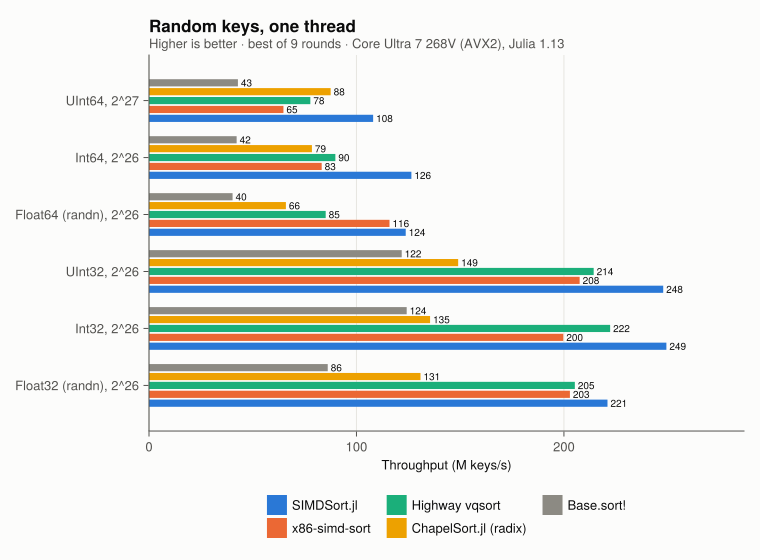
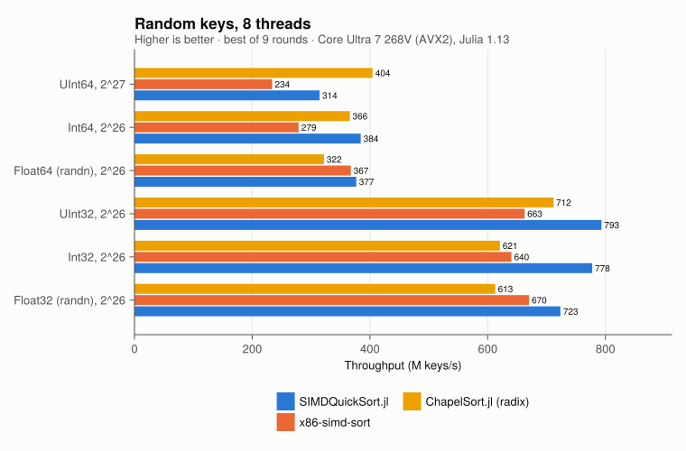
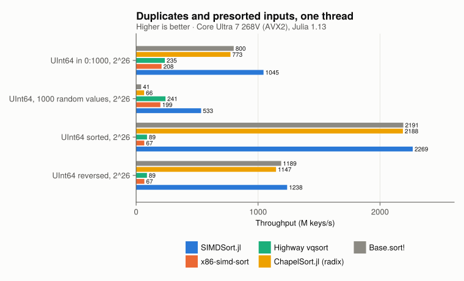
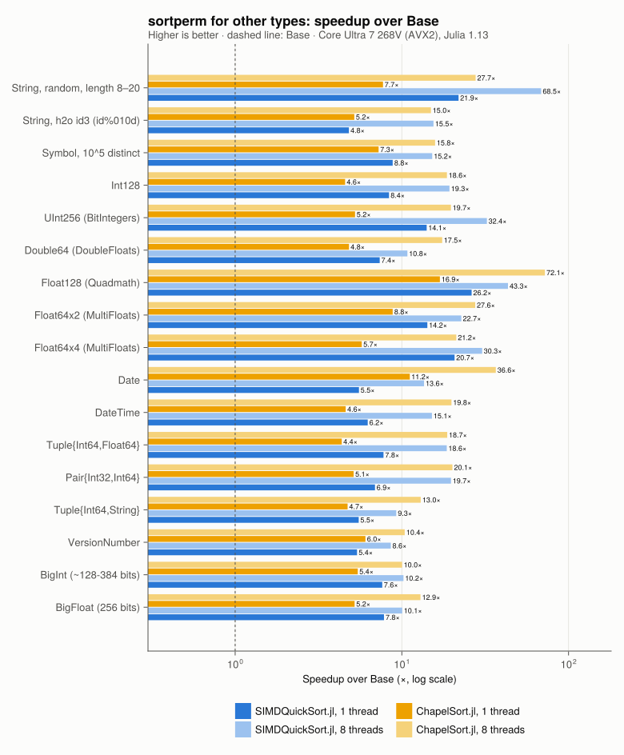
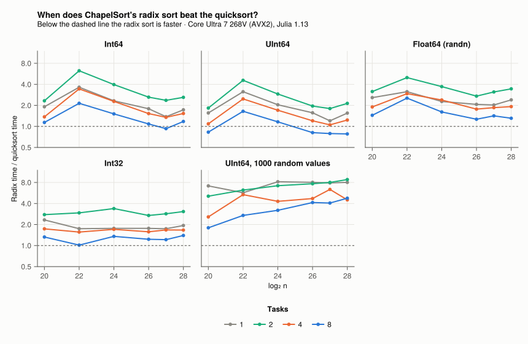

# SIMDSort.jl

*(Formerly SIMDQuickSort.jl: the vectorized quicksort is still the core for
primitive numbers, but counting, hash counting, MSD radix refinement and a
sample-sort step now handle other inputs and types.)*

> [!WARNING]
> SIMDSort.jl depends on an **unreleased fork of SIMD.jl**: branch
> [`permute-compress`](https://github.com/hellemo/SIMD.jl/tree/permute-compress)
> of `hellemo/SIMD.jl`. It adds `vpartition`, `vpermute` and a faster `vstorec`.
> The registered SIMD.jl does not have these functions, so the package does not
> work with it.
> - On Julia 1.11 and later, `Project.toml` takes the fork from GitHub through
>   `[sources]` (`url = "https://github.com/hellemo/SIMD.jl"`,
>   `rev = "permute-compress"`); `Pkg.instantiate()` fetches it.
> - `[sources]` only applies to the active project. When SIMDSort.jl is
>   added to another environment, or on Julia 1.10, add the fork there first:
>   `Pkg.add(url = "https://github.com/hellemo/SIMD.jl", rev = "permute-compress")`.
>
> This will stay so until the changes are merged into SIMD.jl and released.

An experimental vectorized quicksort in pure Julia. It is built on the SIMD.jl
fork with runtime permutes and compress (`vpartition`, `vpermute`), branch
[`permute-compress`](https://github.com/hellemo/SIMD.jl/tree/permute-compress).

```julia
using SIMDSort
v = rand(Int32, 10^8)
simdsort!(v)                                  # one thread
simdsort!(v; ntasks = Threads.nthreads())     # task parallel
simdsort(v; rev = true)                       # sorted copy, reverse order
p = simdsortperm(v)                           # stable, as sortperm
```

The order is that of `isless`: NaNs last, `-0.0` before `0.0`. `simdsortperm` is
stable, like `sortperm`.

Supported element types (in `Vector`s):

| Group | Types |
|---|---|
| Vectorized quicksort | `Int32`, `Int64`, `UInt32`, `UInt64`, `Float32`, `Float64` |
| Strings | `String`, `SubString{String}`, `StringView` (Julia 1.14+), `Symbol` |
| Wide and arbitrary-precision numbers | `Int128`, `UInt128`, BitIntegers.jl types, `BigInt`, `BigFloat` |
| Through extensions (weak dependencies) | Dates (`Date`, `DateTime`, `Time`, Periods), DoubleFloats.jl, MultiFloats.jl, Quadmath.jl (`Float128`) |
| Composite | `Tuple`s and `Pair`s of the above, `VersionNumber` |

Other element types and other array types fall back to `sort!`/`sortperm`.

## How it works

The algorithm follows the published descriptions of vectorized quicksort. It was
written from the papers, without using code from Google Highway (vqsort) or Intel's
x86-simd-sort. [docs/DESIGN.md](docs/DESIGN.md) describes each part, with
citations, the measurements behind the parameter choices, and where the
implementation deviates from the papers.

- **Keys:**
  - integers are mapped in place to signed integers (AVX2 has no unsigned
    compares), and the map is undone after sorting;
  - floats are sorted natively, with NaNs moved out first and signed zeros
    restored by count afterwards;
  - small integer ranges are counted instead of sorted, in one fused pass;
  - few distinct values over a wide range (a Chao1 estimate from 1024 samples)
    are counted in a cache-resident hash table, as in CAFS (Shlyk);
  - `UInt32` is sorted as is (AVX2 has unsigned 32-bit min/max).
- **Partition:** in place and bidirectional (Bramas 2017; Wassenberg et al. 2022).
  Each vector is split with `vpartition`, which is a table lookup plus `vpermd` on
  AVX2, and written with two full-width stores. In cache this costs about 0.11 ns
  per 32-bit key. Ranges larger than the L2 cache use software prefetch.
- **Pivot:** median of lane-wise medians of nine randomly placed vectors.
  - When the sample shows many copies of the pivot, the block of equal keys is
    split off.
  - Ranges of equal keys are detected by a vector min/max scan.
- **Base case:** vectorized sorting networks for up to 256 32-bit or 128 64-bit
  keys.
  - Batcher's network sorts the columns.
  - F5-style zigzag merges (Arman & Loguinov) merge them: odd-row reversal,
    odd-even column merges, then diagonal block exchanges.
  - The 32-row networks are built from two 16-row halves so that they fit in the
    16 AVX2 registers.
  - 64-bit integer leaves are sorted with double min/max (also from F5).
- **Other types:** a key window and the element's position are packed into a
  `UInt64`, the packed keys are sorted, and runs of equal windows are refined with
  the next window, as in an MSD radix sort (McIlroy, Bostic & McIlroy). Strings
  use a cached 16-byte prefix; Symbols use the ranks of their distinct names.
- **Fallbacks and parallelism:**
  - beyond a depth of $2\log_2 n + 4$, `Base.sort!` takes over;
  - with `ntasks > 1`, large ranges are partitioned in parallel and the smaller
    side of each partition becomes a new task.

### Code structure

The kernels are written against key references with a safe (array) and a
raw (pointer) backing. Measured with the same code, the safe one costs
17–19% on one thread (the partition loop reloads the array's data address
around every SIMD.jl store), so the kernels use pointers. Everything around
them works on arrays and views, and the remaining unsafe code is in a few
documented places. docs/DESIGN.md §10 has the measurements.
`bench/ab.jl` compares a baseline source tree against the working tree, run
interleaved in one process; every refactoring step had to pass it.

## Results

Measured on an Intel Core Ultra 7 268V (Lunar Lake: 4 P + 4 E cores, AVX2,
15 GB) with Julia 1.13.2 and 8 threads.
- Each round draws a fresh input, the same for all methods within the round, and
  runs the methods in a shuffled order. No method is timed on an input whose
  branch pattern the predictor has already seen, and thermal drift is spread
  evenly.
- Times are the best of 9 rounds (5 for `Base.sort!`, 3 for the other types);
  the CSV files in `bench/results/` also have the medians.
- x86-simd-sort and vqsort are called through the C shim in ChapelSort.jl's
  `bench/simd`.

To reproduce, run `bench/bench.jl`, `bench/types.jl` and `bench/crossover.jl`,
then `bench/tables.jl` (these tables) and `bench/plots.jl` (the charts).




Seconds per sort; 2^26 keys (2^27 for `UInt64`). In every row the fastest
single-threaded and the fastest 8-thread result are bold.

<!-- table:main -->
| **case**                         | **Base 1 thr** | **ChapelSort 1 thr** | **SIMDSort 1 thr** | **x86-simd-sort 1 thr** | **vqsort 1 thr** | **ChapelSort 8 thr** | **SIMDSort 8 thr** | **x86-simd-sort 8 thr** |
|:---------------------------------|---------------:|---------------------:|-------------------:|------------------------:|-----------------:|---------------------:|-------------------:|------------------------:|
| UInt64, 2^27                     |          3.132 |                1.533 |          **1.242** |                   2.071 |            1.726 |            **0.332** |              0.427 |                   0.574 |
| Int64, 2^26                      |          1.589 |                0.855 |          **0.531** |                   0.806 |            0.747 |                0.183 |          **0.175** |                   0.241 |
| Float64 (randn), 2^26            |          1.666 |                1.017 |          **0.542** |                   0.579 |            0.788 |                0.209 |          **0.178** |                   0.183 |
| UInt32, 2^26                     |          0.551 |                0.450 |          **0.271** |                   0.323 |            0.313 |                0.094 |          **0.085** |                   0.101 |
| Int32, 2^26                      |          0.540 |                0.495 |          **0.269** |                   0.336 |            0.302 |                0.108 |          **0.086** |                   0.105 |
| Float32 (randn), 2^26            |          0.779 |                0.513 |          **0.304** |                   0.331 |            0.327 |                0.110 |          **0.093** |                   0.100 |
| UInt64 in 0:1000, 2^26           |          0.084 |                0.087 |          **0.064** |                   0.322 |            0.285 |                0.030 |          **0.024** |                   0.140 |
| UInt64, 1000 random values, 2^26 |          1.635 |                1.025 |          **0.126** |                   0.338 |            0.279 |                0.132 |          **0.036** |                   0.141 |
| UInt64 sorted, 2^26              |          0.031 |                0.031 |          **0.030** |                   1.007 |            0.751 |            **0.009** |              0.029 |                   0.281 |
| UInt64 reversed, 2^26            |          0.056 |                0.058 |          **0.054** |                   0.998 |            0.757 |            **0.021** |              0.056 |                   0.276 |
| Int32, 2^20                      |          0.005 |                0.007 |          **0.003** |                   0.003 |            0.003 |                0.002 |          **0.001** |                   0.002 |
<!-- /table:main -->

- **One thread:** fastest of all measured sorts for every numeric type, and for
  duplicates and presorted inputs.
  - Against the best C++ sort: Float64 0.542 vs 0.579 s (x86-simd-sort), Int32
    0.269 vs 0.302 s (vqsort), UInt64 1.24 vs 1.73 s (vqsort).
  - Few distinct values: small ranges are counted, other few-distinct inputs are
    counted in a hash table. 1000 random `UInt64` values: 0.126 s, against 0.279
    for vqsort.
- **Eight threads:** fastest for `Int64`, `Float64`, the 32-bit types and
  duplicate-heavy inputs. ChapelSort's parallel radix sort leads for `UInt64` at
  2^27 keys and for presorted inputs.



### Other types



10^7 elements (BigInt, BigFloat, Float64x4, VersionNumber: 10^6), best of 3
rounds:

<!-- table:types -->
| **case, operation**                   | **Base 1 thr** | **ChapelSort 1 thr** | **SIMDSort 1 thr** | **ChapelSort 8 thr** | **SIMDSort 8 thr** |
|:--------------------------------------|---------------:|---------------------:|-------------------:|---------------------:|-------------------:|
| String, random, length 8–20, sort     |          5.588 |                1.482 |          **0.794** |            **0.409** |              0.412 |
| String, random, length 8–20, sortperm |         13.790 |                1.796 |          **0.641** |                0.490 |          **0.215** |
| String, h2o id3 (id%010d), sort       |          3.519 |            **1.270** |              1.894 |            **0.416** |              0.618 |
| String, h2o id3 (id%010d), sortperm   |          8.217 |            **1.663** |              1.753 |                0.616 |          **0.454** |
| Symbol, 10^5 distinct, sort           |          1.132 |                0.298 |          **0.161** |            **0.063** |              0.145 |
| Symbol, 10^5 distinct, sortperm       |          3.709 |                0.509 |          **0.411** |            **0.234** |              0.276 |
| Int128, sort                          |          0.426 |                0.281 |          **0.198** |                0.074 |          **0.047** |
| Int128, sortperm                      |          1.916 |                0.456 |          **0.242** |                0.109 |          **0.105** |
| UInt256 (BitIntegers), sort           |          0.706 |                0.371 |          **0.279** |                0.100 |          **0.084** |
| UInt256 (BitIntegers), sortperm       |          3.137 |                0.643 |          **0.251** |                0.150 |          **0.112** |
| Double64 (DoubleFloats), sort         |          0.998 |                0.738 |          **0.285** |                0.152 |          **0.059** |
| Double64 (DoubleFloats), sortperm     |          2.682 |                0.561 |          **0.354** |            **0.143** |              0.236 |
| Float128 (Quadmath), sort             |          2.816 |                0.398 |          **0.241** |                0.100 |          **0.069** |
| Float128 (Quadmath), sortperm         |          8.838 |                0.523 |          **0.364** |            **0.133** |              0.210 |
| Float64x2 (MultiFloats), sort         |          0.827 |                0.746 |          **0.273** |                0.166 |          **0.065** |
| Float64x2 (MultiFloats), sortperm     |          4.184 |                0.505 |          **0.296** |            **0.125** |              0.172 |
| Float64x4 (MultiFloats), sort         |          0.074 |                0.050 |          **0.030** |                0.013 |          **0.009** |
| Float64x4 (MultiFloats), sortperm     |          0.386 |                0.063 |          **0.016** |                0.016 |          **0.012** |
| Date, sort                            |          0.185 |                0.081 |          **0.053** |                0.025 |          **0.020** |
| Date, sortperm                        |          1.638 |            **0.148** |              0.261 |            **0.040** |              0.111 |
| DateTime, sort                        |          0.237 |                0.206 |          **0.068** |                0.041 |          **0.022** |
| DateTime, sortperm                    |          1.542 |                0.368 |          **0.267** |            **0.077** |              0.119 |
| Tuple{Int64,Float64}, sort            |          0.744 |                0.541 |          **0.231** |                0.122 |          **0.057** |
| Tuple{Int64,Float64}, sortperm        |          2.584 |                0.596 |          **0.345** |                0.152 |          **0.135** |
| Pair{Int32,Int64}, sort               |          0.462 |                0.272 |          **0.200** |                0.076 |          **0.053** |
| Pair{Int32,Int64}, sortperm           |          2.251 |                0.458 |          **0.283** |            **0.112** |              0.114 |
| Tuple{Int64,String}, sort             |          0.699 |                0.515 |          **0.337** |            **0.154** |              0.209 |
| Tuple{Int64,String}, sortperm         |          1.719 |                0.346 |          **0.296** |            **0.136** |              0.193 |
| VersionNumber, sort                   |          0.149 |            **0.061** |              0.066 |                0.044 |          **0.040** |
| VersionNumber, sortperm               |          0.297 |            **0.049** |              0.053 |            **0.029** |              0.034 |
| BigInt (\~128-384 bits), sort         |          0.512 |                0.170 |          **0.148** |                0.108 |          **0.104** |
| BigInt (\~128-384 bits), sortperm     |          1.088 |                0.214 |          **0.136** |            **0.104** |              0.123 |
| BigFloat (256 bits), sort             |          0.578 |                0.216 |          **0.150** |                0.104 |          **0.101** |
| BigFloat (256 bits), sortperm         |          1.063 |                0.229 |          **0.142** |            **0.103** |              0.109 |
<!-- /table:types -->

- **`sortperm`:** SIMDSort wins most rows on one thread.
- **`sort` for wide fixed-width types** (Int128, UInt256, Float128, Double64,
  MultiFloats, packed tuples and pairs): one sample-sort distribution pass, then
  cache-resident SIMD sorts of the buckets (docs/DESIGN.md §8). It used to go
  through a permutation and a gather.
- **8 threads:** SIMDSort leads in 19 of 34 rows, including `sort` for
  every fixed-width type. ChapelSort's radix sort leads in most 8-thread
  `sortperm` rows and for strings and Symbols.


### Quicksort or radix sort?



The radix sort is faster only with 8 tasks, for 64-bit integer keys (and for
`UInt64` mostly at ≥ 2^26 keys). The quicksort is faster for everything else,
including all floats and all 32-bit keys. See docs/DESIGN.md §7.h.

[docs/DESIGN.md §7](docs/DESIGN.md) has the profile breakdown, per-level costs,
the effect of each optimization, the analysis of the remaining gaps, and the
ideas that were rejected. `bench/profile.jl` reproduces the breakdown.

## Limitations

- Tuned and tested on one AVX2 machine only, with 256-bit vectors.
  - CPUs without AVX2 (and ARM) get SIMD.jl's portable lowering. It is correct
    and covered by the tests with `SIMD_JL_GENERIC=1`, but about 4× slower.
  - On AVX-512 the code selects the single 32-row network and native 64-bit
    min/max, but has not been measured there. [docs/AVX512.md](docs/AVX512.md)
    describes what remains to be measured, and `bench/avx512.jl` measures it.
- No `by` or `lt` keywords.
- `simdsort!` on the six primitive types is not stable. This only matters for
  distinguishable equal keys, such as NaNs with different payloads.
  `simdsortperm`, and `simdsort!` on all other types, are stable.
- Depends on the unreleased SIMD.jl fork (see the warning at the top).

## Tests

```sh
julia --project=. -e 'using Pkg; Pkg.test()'
JULIA_NUM_THREADS=8 SIMD_JL_GENERIC=1 julia --project=. test/runtests.jl
```

Passes on Julia 1.10, 1.13 and 1.14-alpha, and with the portable lowering.

## References

Papers whose ideas are used. The code names them where they are applied (see
the source map at the top of `src/SIMDSort.jl`):

- **[WBGS22]** J. Wassenberg, M. Blacher, J. Giesen, P. Sanders. *Vectorized and
  performance-portable quicksort.* Software: Practice and Experience 52(12), 2022.
  [arXiv:2205.05982](https://arxiv.org/abs/2205.05982). Used for the recursion,
  partitioning and pivot sampling, and the register-matrix base case.
- **[Bra17]** B. Bramas. *A Novel Hybrid Quicksort Algorithm Vectorized using
  AVX-512 on Intel Skylake.* IJACSA 8(10), 2017.
  [arXiv:1704.08579](https://arxiv.org/abs/1704.08579). Used for the in-place
  bidirectional partition.
- **[F5]** A. Arman, D. Loguinov. *F5: A Robust SIMD-Accelerated MSD Radix Sort.*
  Texas A&M University; listed as ICDE 2026. Used for:
  - zigzag-merge networks;
  - double min/max for 64-bit integers;
  - skipping common key bits.
- **[Bat68]** K. E. Batcher. *Sorting networks and their applications.* AFIPS
  1968. Used for the odd-even merge sort and merge networks.
- **[Hoa62]** C. A. R. Hoare. *Quicksort.* The Computer Journal 5(1), 1962.
- **[Mus97]** D. R. Musser. *Introspective sorting and selection algorithms.* SPE
  27(8), 1997. Used for the depth limit with a fallback sort.
- **[MBM93]** P. M. McIlroy, K. Bostic, M. D. McIlroy. *Engineering radix sort.*
  Computing Systems 6(1), 1993. Used for the MSD refinement of string keys.
- **[CAFS]** V. S. Shlyk. *CAFS: A Cache-Aware Frequency Sort for Low-Cardinality
  Integer Data on x86-64.* [arXiv:2605.25040](https://arxiv.org/abs/2605.25040),
  2026. Used for the Chao1 estimate of distinct keys and hash counting.

- **[IPS4o]** M. Axtmann, S. Witt, D. Ferizovic, P. Sanders. *Engineering
  in-place (shared-memory) sorting algorithms.* ACM TOPC, 2022.
  [arXiv:2009.13569](https://arxiv.org/abs/2009.13569). Used for the
  sample-sort distribution step in `sort!` for wide fixed-width types
  (splitters from a sorted sample, branch-free bucket search).

The implementation is written from these papers. It uses no code from Google
Highway (vqsort), Intel's x86-simd-sort or F5.

## License

MIT, Copyright (c) 2026 Lars Hellemo.
