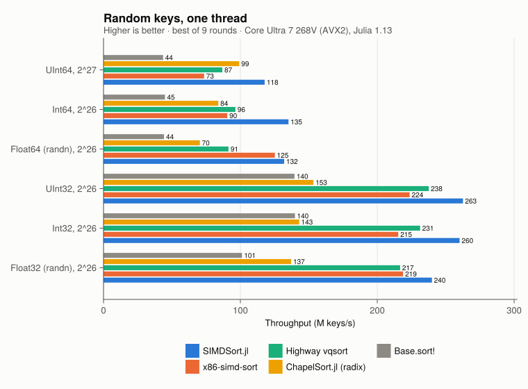
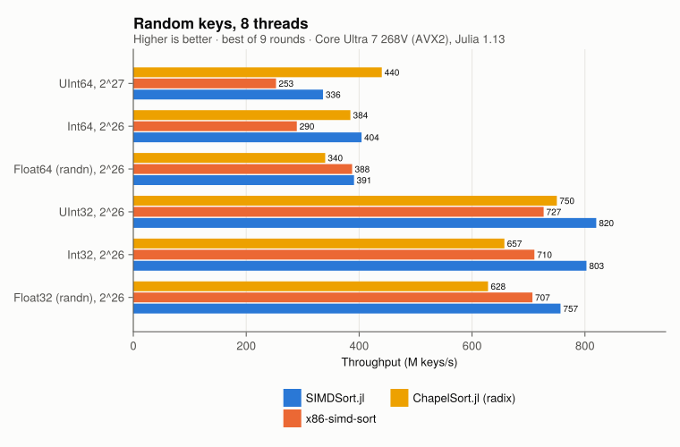
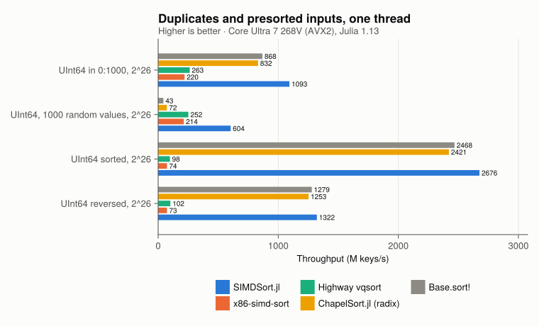
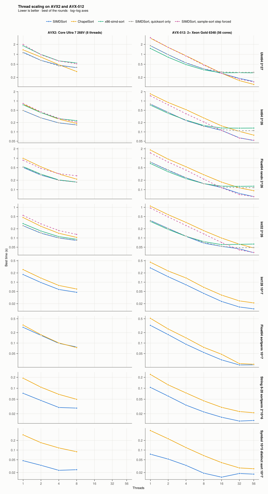
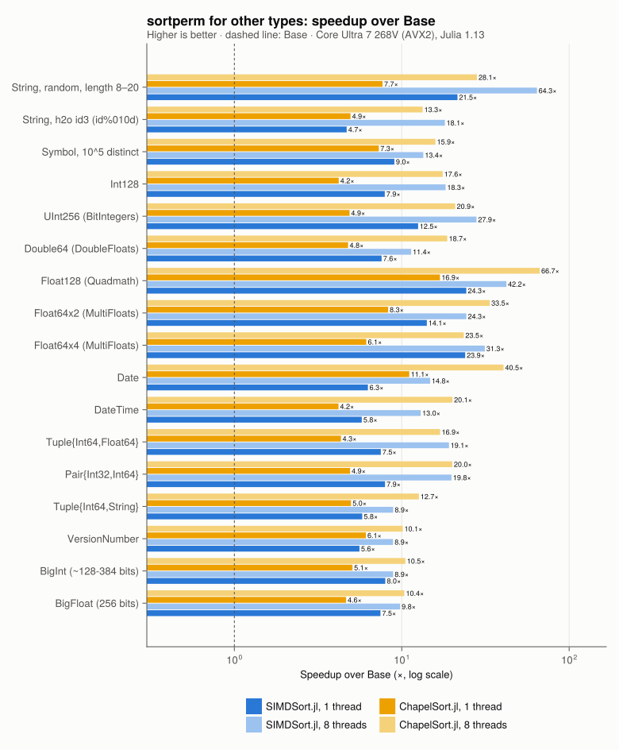
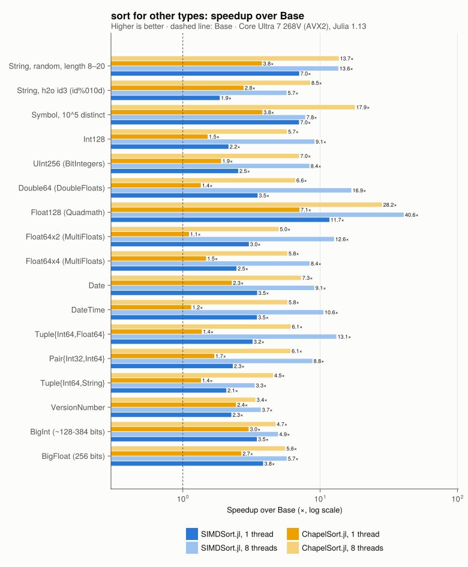
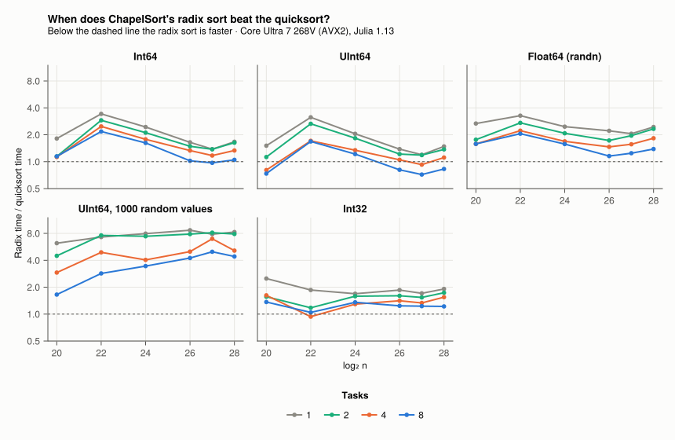

# SIMDSort.jl

[](https://hellemo.github.io/SIMDSort.jl/dev/)
[](https://github.com/hellemo/SIMDSort.jl/actions/workflows/CI.yml?query=branch%3Amain)

> [!WARNING]
> SIMDSort.jl depends on an **unreleased fork of SIMD.jl**: branch
> [`permute-compress`](https://github.com/hellemo/SIMD.jl/tree/permute-compress)
> of `hellemo/SIMD.jl`. It adds `vpartition`, `vpermute` and a faster `vstorec`.
> The registered SIMD.jl does not have these functions, so the package does not
> work with it.
> - On Julia 1.11 and later, `Project.toml` takes the fork from GitHub through
>   `[sources]` (`url = "https://github.com/hellemo/SIMD.jl"`,
>   `rev = "permute-compress"`); `Pkg.instantiate()` fetches it.
> - `[sources]` only applies to the active project. When SIMDSort.jl is
>   added to another environment, or on Julia 1.10, add the fork there first:
>   `Pkg.add(url = "https://github.com/hellemo/SIMD.jl", rev = "permute-compress")`.
>
> This will stay so until the changes are merged into SIMD.jl and released.

Experimental vectorized sorting in pure Julia: a vectorized quicksort for
primitive numbers, with counting, hash counting, MSD radix refinement and a
sample-sort step for other inputs, types and many threads. It is built on the
SIMD.jl fork with runtime permutes and compress (`vpartition`, `vpermute`),
branch [`permute-compress`](https://github.com/hellemo/SIMD.jl/tree/permute-compress).

```julia
using SIMDSort
v = rand(Int32, 10^8)
simdsort!(v)                                  # one thread
simdsort!(v; ntasks = Threads.nthreads())     # task parallel
simdsort(v; rev = true)                       # sorted copy, reverse order
p = simdsortperm(v)                           # stable, as sortperm
```

The order is that of `isless`: NaNs last, `-0.0` before `0.0`. `simdsortperm` is
stable, like `sortperm`.

Supported element types (in `Vector`s; `simdsort!` of the primitive numbers
also sorts contiguous views `view(v, a:b)` in place, and other arrays of these
types, such as views and matrix columns, are sorted as a `Vector` copy):

| Group | Types |
|---|---|
| Vectorized quicksort | `Int32`, `Int64`, `UInt32`, `UInt64`, `Float32`, `Float64` |
| Strings | `String`, `SubString{String}`, `StringView` (Julia 1.14+), `Symbol` |
| Wide and arbitrary-precision numbers | `Int128`, `UInt128`, BitIntegers.jl types, `BigInt`, `BigFloat` |
| Through extensions (weak dependencies) | Dates (`Date`, `DateTime`, `Time`, Periods), DoubleFloats.jl, MultiFloats.jl, Quadmath.jl (`Float128`), InlineStrings.jl (`String1` ... `String255`) |
| Small types | `Int8`, `Int16`, `UInt8`, `UInt16`, `Char`, `Float16` |
| Missing values | `Union{Missing,T}` for any `T` above |
| Pooled arrays (DataAPI `refpool`) | `PooledArray`, `CategoricalArray`: sorted through their refs |
| Composite | `Tuple`s and `Pair`s of the above, `VersionNumber` |

Other element types and other array types fall back to `sort!`/`sortperm`.

## How it works

The algorithm follows the published descriptions of vectorized quicksort. It was
written from the papers, without using code from Google Highway (vqsort) or Intel's
x86-simd-sort. [docs/src/design.md](docs/src/design.md) describes each part, with
citations, the measurements behind the parameter choices, and where the
implementation deviates from the papers.

- **Keys:**
  - integers are mapped in place to signed integers (AVX2 has no unsigned
    compares), and the map is undone after sorting;
  - floats are sorted natively, with NaNs moved out first and signed zeros
    restored by count afterwards;
  - small integer ranges are counted instead of sorted, in one fused pass;
  - few distinct values over a wide range (a Chao1 estimate from 1024 samples)
    are counted in a cache-resident hash table, as in CAFS (Shlyk);
  - `UInt32` is sorted as is (AVX2 has unsigned 32-bit min/max).
- **Partition:** in place and bidirectional (Bramas 2017; Wassenberg et al. 2022).
  Each vector is split with `vpartition`, which is a table lookup plus `vpermd` on
  AVX2, and written with two full-width stores. In cache this costs about 0.11 ns
  per 32-bit key. Ranges larger than the L2 cache use software prefetch.
- **Pivot:** median of lane-wise medians of nine randomly placed vectors.
  - When the sample shows many copies of the pivot, the block of equal keys is
    split off.
  - Ranges of equal keys are detected by a vector min/max scan.
- **Base case:** vectorized sorting networks for up to 256 32-bit or 128 64-bit
  keys.
  - Batcher's network sorts the columns.
  - F5-style zigzag merges (Arman & Loguinov) merge them: odd-row reversal,
    odd-even column merges, then diagonal block exchanges.
  - The 32-row networks are built from two 16-row halves so that they fit in the
    16 AVX2 registers.
  - 64-bit integer leaves are sorted with double min/max (also from F5).
- **Other types:** a key window and the element's position are packed into a
  `UInt64`, the packed keys are sorted, and runs of equal windows are refined with
  the next window, as in an MSD radix sort (McIlroy, Bostic & McIlroy). Strings
  use a cached 16-byte prefix; Symbols use the ranks of their distinct names.
- **Fallbacks and parallelism:**
  - beyond a depth of $2\log_2 n + 4$, `Base.sort!` takes over;
  - with `ntasks > 1`, large ranges are partitioned in parallel and the smaller
    side of each partition becomes a new task.

### Code structure

The kernels are written against key references with a safe (array) and a
raw (pointer) backing. Measured with the same code, the safe one costs
17–19% on one thread (the partition loop reloads the array's data address
around every SIMD.jl store), so the kernels use pointers. Everything around
them works on arrays and views, and the remaining unsafe code is in a few
documented places. docs/src/design.md §10 has the measurements.
`bench/ab.jl` compares a baseline source tree against the working tree, run
interleaved in one process; every refactoring step had to pass it.

### Documentation

The documentation (usage, API, benchmarks, the design document, AVX-512
notes, the measuring scripts, internals) is built with Documenter:
`julia --project=docs -e 'using Pkg; Pkg.instantiate()'`, then
`julia --project=docs docs/make.jl` (HTML in `docs/build/`).

A shared library with C entry points for the six primitive types, built with
JuliaC and trimmed, is in `lib/` (see the "C library" page of the docs).

## Results

Measured on an Intel Core Ultra 7 268V (Lunar Lake: 4 P + 4 E cores, AVX2,
15 GB) with Julia 1.13.2 and 8 threads.
- Each round draws a fresh input, the same for all methods within the round, and
  runs the methods in a shuffled order. No method is timed on an input whose
  branch pattern the predictor has already seen, and thermal drift is spread
  evenly.
- Times are the best of 9 rounds (5 for `Base.sort!`, 3 for the other types);
  the CSV files in `bench/results/` also have the medians.
- x86-simd-sort and vqsort are called through the C shim in ChapelSort.jl's
  `bench/simd`.

To reproduce, run `bench/bench.jl`, `bench/types.jl` and `bench/crossover.jl`,
then `bench/tables.jl` (these tables) and `bench/plots.jl` (the charts).




Seconds per sort; 2^26 keys (2^27 for `UInt64`). In every row the fastest
single-threaded and the fastest 8-thread result are bold.

<!-- table:main -->
| **case**                         | **Base 1 thr** | **ChapelSort 1 thr** | **SIMDSort 1 thr** | **x86-simd-sort 1 thr** | **vqsort 1 thr** | **ChapelSort 8 thr** | **SIMDSort 8 thr** | **x86-simd-sort 8 thr** |
|:---------------------------------|---------------:|---------------------:|-------------------:|------------------------:|-----------------:|---------------------:|-------------------:|------------------------:|
| UInt64, 2^27                     |          3.062 |                1.362 |          **1.168** |                   1.818 |            1.575 |            **0.300** |              0.406 |                   0.542 |
| Int64, 2^26                      |          1.513 |                0.787 |          **0.501** |                   0.752 |            0.696 |                0.176 |          **0.168** |                   0.232 |
| Float64 (randn), 2^26            |          1.453 |                0.947 |          **0.512** |                   0.538 |            0.736 |                0.202 |          **0.172** |                   0.172 |
| UInt32, 2^26                     |          0.484 |                0.435 |          **0.251** |                   0.299 |            0.281 |                0.087 |          **0.082** |                   0.092 |
| Int32, 2^26                      |          0.507 |                0.460 |          **0.256** |                   0.311 |            0.286 |                0.106 |          **0.084** |                   0.096 |
| Float32 (randn), 2^26            |          0.668 |                0.483 |          **0.280** |                   0.310 |            0.307 |                0.102 |          **0.094** |                   0.094 |
| UInt64 in 0:1000, 2^26           |          0.079 |                0.081 |          **0.061** |                   0.307 |            0.259 |                0.028 |          **0.025** |                   0.128 |
| UInt64, 1000 random values, 2^26 |          1.519 |                0.927 |          **0.119** |                   0.309 |            0.266 |                0.122 |          **0.037** |                   0.132 |
| UInt64 sorted, 2^26              |          0.028 |                0.028 |          **0.026** |                   0.917 |            0.677 |                0.009 |          **0.009** |                   0.272 |
| UInt64 reversed, 2^26            |          0.052 |                0.054 |          **0.050** |                   0.906 |            0.669 |                0.019 |          **0.019** |                   0.262 |
| Int32, 2^20                      |          0.005 |                0.007 |          **0.003** |                   0.003 |            0.003 |                0.002 |          **0.002** |                   0.003 |
<!-- /table:main -->

- **One thread:** fastest of all measured sorts for every numeric type, and for
  duplicates and presorted inputs.
  - Against the best C++ sort: Float64 0.512 vs 0.538 s (x86-simd-sort), Int32
    0.256 vs 0.286 s (vqsort), UInt64 1.17 vs 1.58 s (vqsort).
  - Few distinct values: small ranges are counted, other few-distinct inputs are
    counted in a hash table. 1000 random `UInt64` values: 0.119 s, against 0.266
    for vqsort.
- **Eight threads:** fastest for `Int64`, `Float64`, the 32-bit types,
  duplicate-heavy and presorted inputs. ChapelSort's parallel radix sort leads
  for `UInt64` at 2^27 keys (0.300 vs 0.406 s), where the laptop's memory
  bandwidth is the limit.
- **Many cores and AVX-512:** see [below](#avx-512-and-many-cores).



### AVX-512 and many cores

Measured on a 2 × 28-core Intel Xeon Gold 6348 (Ice Lake-SP, AVX-512,
2 NUMA nodes) with `bench/measure/scaling.jl`: best of 5 fresh inputs, seconds.
With AVX-512 the kernels use 512-bit vectors (native compress, 16-row
512-bit base-case networks), and `UInt64` needs no key map
(docs/src/avx512.md). From 16 threads and large inputs a sample-sort step
replaces the top partition levels, which stop scaling (docs/src/design.md §7j).

<!-- table:xeon -->
| **case**                       | **SIMDSort 1 thr** | **ChapelSort 1 thr** | **x86-simd-sort 1 thr** | **SIMDSort 56 thr** | **ChapelSort 56 thr** | **x86-simd-sort 56 thr** |
|:-------------------------------|-------------------:|---------------------:|------------------------:|--------------------:|----------------------:|-------------------------:|
| UInt64 2^27                    |          **1.493** |                3.044 |                   1.525 |           **0.096** |                 0.121 |                    0.274 |
| Int64 2^26                     |          **0.690** |                1.672 |                   0.727 |           **0.051** |                 0.082 |                    0.134 |
| Float64 randn 2^26             |              0.759 |                1.819 |               **0.685** |           **0.056** |                 0.094 |                    0.128 |
| Int32 2^26                     |              0.353 |                1.093 |               **0.347** |           **0.033** |                 0.047 |                    0.062 |
| Int128 10^7                    |          **0.270** |                0.440 |                       – |           **0.013** |                 0.021 |                        – |
| Float64 sortperm 10^7          |          **0.236** |                0.494 |                       – |           **0.016** |                 0.024 |                        – |
| String 8-20 sortperm 2\*10^6   |          **0.094** |                0.227 |                       – |           **0.011** |                 0.021 |                        – |
| Symbol 10^5 distinct sort 10^7 |          **0.069** |                0.403 |                       – |           **0.016** |                 0.027 |                        – |
<!-- /table:xeon -->



- **One thread:** SIMDSort leads x86-simd-sort for `Int64` (0.69 vs 0.73 s)
  and `UInt64` (1.49 vs 1.52 s) and trails it for `Int32` (1.5%) and `Float64`
  (11%: 512-bit floating point lowers the clock, docs/src/avx512.md).
- **56 threads:** SIMDSort leads every case; the parallel quicksorts
  (x86-simd-sort's included) stop scaling at about 16 threads.

### Other types



10^7 elements (BigInt, BigFloat, Float64x4, VersionNumber: 10^6), best of 3
rounds:

<!-- table:types -->
| **case, operation**                   | **Base 1 thr** | **ChapelSort 1 thr** | **SIMDSort 1 thr** | **ChapelSort 8 thr** | **SIMDSort 8 thr** |
|:--------------------------------------|---------------:|---------------------:|-------------------:|---------------------:|-------------------:|
| String, random, length 8–20, sort     |          4.890 |                1.353 |          **0.664** |                0.309 |          **0.219** |
| String, random, length 8–20, sortperm |         11.766 |                1.733 |          **0.560** |                0.519 |          **0.142** |
| String, h2o id3 (id%010d), sort       |          3.233 |                1.153 |          **1.135** |                0.378 |          **0.323** |
| String, h2o id3 (id%010d), sortperm   |          7.385 |                1.489 |          **1.026** |                0.546 |          **0.255** |
| Symbol, 10^5 distinct, sort           |          1.130 |                0.306 |          **0.042** |                0.095 |          **0.023** |
| Symbol, 10^5 distinct, sortperm       |          3.299 |                0.480 |          **0.248** |                0.221 |          **0.093** |
| Int128, sort                          |          0.405 |                0.274 |          **0.182** |                0.077 |          **0.056** |
| Int128, sortperm                      |          1.671 |                0.434 |          **0.158** |                0.110 |          **0.054** |
| UInt256 (BitIntegers), sort           |          0.632 |                0.341 |          **0.264** |                0.085 |          **0.073** |
| UInt256 (BitIntegers), sortperm       |          2.528 |                0.644 |          **0.163** |                0.165 |          **0.061** |
| Double64 (DoubleFloats), sort         |          0.950 |                0.709 |          **0.270** |                0.160 |          **0.067** |
| Double64 (DoubleFloats), sortperm     |          2.285 |                0.529 |          **0.229** |                0.146 |          **0.080** |
| Float128 (Quadmath), sort             |          2.673 |                0.387 |          **0.208** |                0.095 |          **0.063** |
| Float128 (Quadmath), sortperm         |          8.671 |                0.552 |          **0.303** |                0.123 |          **0.101** |
| Float64x2 (MultiFloats), sort         |          0.830 |                0.711 |          **0.257** |                0.162 |          **0.065** |
| Float64x2 (MultiFloats), sortperm     |          4.191 |                0.465 |          **0.238** |                0.132 |          **0.076** |
| Float64x4 (MultiFloats), sort         |          0.072 |                0.047 |          **0.029** |                0.014 |          **0.008** |
| Float64x4 (MultiFloats), sortperm     |          0.322 |                0.059 |          **0.015** |                0.015 |          **0.007** |
| Date, sort                            |          0.191 |                0.097 |          **0.051** |                0.025 |          **0.021** |
| Date, sortperm                        |          1.456 |            **0.159** |              0.179 |            **0.041** |              0.060 |
| DateTime, sort                        |          0.261 |                0.220 |          **0.067** |                0.045 |          **0.024** |
| DateTime, sortperm                    |          1.382 |                0.353 |          **0.176** |                0.080 |          **0.062** |
| Tuple{Int64,Float64}, sort            |          0.706 |                0.499 |          **0.218** |                0.118 |          **0.057** |
| Tuple{Int64,Float64}, sortperm        |          2.296 |                0.588 |          **0.278** |                0.143 |          **0.089** |
| Pair{Int32,Int64}, sort               |          0.451 |                0.257 |          **0.193** |                0.066 |          **0.048** |
| Pair{Int32,Int64}, sortperm           |          2.021 |                0.472 |          **0.237** |                0.117 |          **0.079** |
| Tuple{Int64,String}, sort             |          0.708 |                0.526 |          **0.281** |                0.183 |          **0.090** |
| Tuple{Int64,String}, sortperm         |          1.482 |                0.424 |          **0.256** |                0.127 |          **0.079** |
| VersionNumber, sort                   |          0.154 |            **0.064** |              0.075 |                0.042 |          **0.041** |
| VersionNumber, sortperm               |          0.285 |            **0.047** |              0.060 |            **0.029** |              0.034 |
| BigInt (\~128-384 bits), sort         |          0.495 |                0.194 |          **0.167** |                0.097 |          **0.061** |
| BigInt (\~128-384 bits), sortperm     |          1.040 |                0.180 |          **0.176** |                0.105 |          **0.058** |
| BigFloat (256 bits), sort             |          0.600 |                0.224 |          **0.151** |                0.092 |          **0.060** |
| BigFloat (256 bits), sortperm         |          0.915 |                0.194 |          **0.107** |                0.088 |          **0.048** |
<!-- /table:types -->

- **`sort` for wide fixed-width types** (Int128, UInt256, Float128, Double64,
  MultiFloats, packed tuples and pairs): one sample-sort distribution pass, then
  cache-resident SIMD sorts of the buckets (docs/src/design.md §8). It used to go
  through a permutation and a gather.
- **One thread:** SIMDSort leads in 31 of 34 rows; ChapelSort in Date
  `sortperm` and VersionNumber `sort` and `sortperm`.
- **8 threads:** SIMDSort leads in 32 of 34 rows, including strings, Symbols
  (counted in hash tables by address: 0.023 s against 0.095), the wide
  floats, tuples, BigInt and BigFloat; ChapelSort's radix sort in Date and
  VersionNumber `sortperm`.



### Quicksort or radix sort?



The radix sort is faster only for `UInt64` with 4–8 tasks (at ≥ 2^26 keys with
8 tasks, and at 2^20). The quicksort is faster for everything else, including
`Int64`, all floats and all 32-bit keys. See docs/src/design.md §7.h.

[docs/src/design.md §7](docs/src/design.md) has the profile breakdown, per-level costs,
the effect of each optimization, the analysis of the remaining gaps, and the
ideas that were rejected. `bench/profile.jl` reproduces the breakdown.

### Tuning data from other machines

The kernels and thresholds were tuned on the two machines above. On another
processor (AMD Zen 4/5, newer Intel server parts, ARM, ...), please run
`SIMDSort.tuning_report()` in a Julia started with all threads and send the
file it writes with an issue; docs/src/measuring.md lists the processors
where data would help most.

## Limitations

- Tuned on two x86 machines only: an AVX2 laptop and an AVX-512 Xeon (Ice
  Lake-SP). Other architectures need tuning data; see
  [Tuning data from your machine](docs/src/measuring.md).
  - CPUs without AVX2, and ARM, get SIMD.jl's portable lowering. It is correct
    (CI runs the tests with `SIMD_JL_GENERIC=1` and on Apple silicon), but on
    x86 about 4× slower than the AVX2 kernels; ARM speed is not measured yet.
- No `by` or `lt` keywords.
- `simdsort!` on the six primitive types is not stable. This only matters for
  distinguishable equal keys, such as NaNs with different payloads.
  `simdsortperm`, and `simdsort!` on all other types, are stable.
- Depends on the unreleased SIMD.jl fork (see the warning at the top).

## Tests

```sh
julia --project=. -e 'using Pkg; Pkg.test()'
JULIA_NUM_THREADS=8 SIMD_JL_GENERIC=1 julia --project=. test/runtests.jl
```

Passes on Julia 1.10, 1.13 and 1.14-alpha, and with the portable lowering.

## References

Papers whose ideas are used. The code names them where they are applied (see
the source map at the top of `src/SIMDSort.jl`):

- **[WBGS22]** J. Wassenberg, M. Blacher, J. Giesen, P. Sanders. *Vectorized and
  performance-portable quicksort.* Software: Practice and Experience 52(12), 2022.
  [arXiv:2205.05982](https://arxiv.org/abs/2205.05982). Used for the recursion,
  partitioning and pivot sampling, and the register-matrix base case.
- **[Bra17]** B. Bramas. *A Novel Hybrid Quicksort Algorithm Vectorized using
  AVX-512 on Intel Skylake.* IJACSA 8(10), 2017.
  [arXiv:1704.08579](https://arxiv.org/abs/1704.08579). Used for the in-place
  bidirectional partition.
- **[F5]** A. Arman, D. Loguinov. *F5: A Robust SIMD-Accelerated MSD Radix Sort.*
  Texas A&M University; listed as ICDE 2026. Used for:
  - zigzag-merge networks;
  - double min/max for 64-bit integers;
  - skipping common key bits.
- **[Bat68]** K. E. Batcher. *Sorting networks and their applications.* AFIPS
  1968. Used for the odd-even merge sort and merge networks.
- **[Hoa62]** C. A. R. Hoare. *Quicksort.* The Computer Journal 5(1), 1962.
- **[Mus97]** D. R. Musser. *Introspective sorting and selection algorithms.* SPE
  27(8), 1997. Used for the depth limit with a fallback sort.
- **[MBM93]** P. M. McIlroy, K. Bostic, M. D. McIlroy. *Engineering radix sort.*
  Computing Systems 6(1), 1993. Used for the MSD refinement of string keys.
- **[CAFS]** V. S. Shlyk. *CAFS: A Cache-Aware Frequency Sort for Low-Cardinality
  Integer Data on x86-64.* [arXiv:2605.25040](https://arxiv.org/abs/2605.25040),
  2026. Used for the Chao1 estimate of distinct keys and hash counting.

- **[IPS4o]** M. Axtmann, S. Witt, D. Ferizovic, P. Sanders. *Engineering
  in-place (shared-memory) sorting algorithms.* ACM TOPC, 2022.
  [arXiv:2009.13569](https://arxiv.org/abs/2009.13569). Used for the
  sample-sort distribution step in `sort!` for wide fixed-width types
  (splitters from a sorted sample, branch-free bucket search).

The implementation is written from these papers. It uses no code from Google
Highway (vqsort), Intel's x86-simd-sort or F5.

## License

MIT, Copyright (c) 2026 Lars Hellemo.
